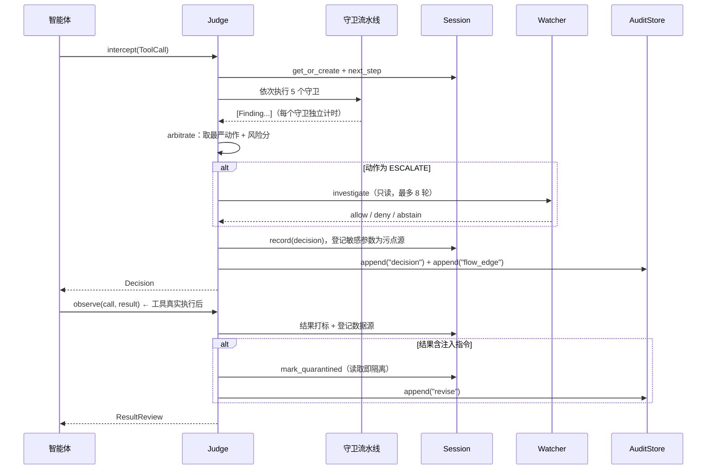

# 架构设计

## 1. 分层

```
┌────────────────────────────────────────────────────────────────────┐
│ 接入层  CLI · HTTP API · Python SDK · MCP 代理 · OpenClaw 插件      │
├────────────────────────────────────────────────────────────────────┤
│ 裁决层  Judge：守卫流水线 → 风险聚合 → 语义研判 → 三态裁决          │
├────────────────────────────────────────────────────────────────────┤
│ 判定层  canary · stego · contract · rules · dataflow               │
├────────────────────────────────────────────────────────────────────┤
│ 状态层  Session：步骤、数据源、污点标签、蜜标、已写路径             │
├────────────────────────────────────────────────────────────────────┤
│ 证据层  AuditStore：HMAC 链 + 独立尾锚 + 取证导出                   │
├────────────────────────────────────────────────────────────────────┤
│ 治理层  Policy（TOML）· Contracts（TOML）· SkillCheck（言行体检）    │
└────────────────────────────────────────────────────────────────────┘
```

设计约束：**零运行时依赖**。只用 Python 3.11+ 标准库（`tomllib`、`sqlite3`、
`hmac`、`http.server`、`ast`、`urllib`）。这让系统可以整体拷进内网、离线运行、
无需 GPU，也避免供应链风险——对一个安全产品尤其重要。

## 2. 一次裁决的时序



## 3. 关键设计取舍

### 3.1 为什么是「三态」而不是「放行/拒绝」

安全产品最大的敌人是误报导致业务绕过。加入 `ESCALATE`（转人工）后：

- 确定性命中 → 直接拒绝，零延迟；
- 灰区（规则只给中危、语义不清）→ 挂起等人工，工作台一键放行/拒绝；
- 人工结论写回审计链（`review` 记录），成为后续追责依据。

### 3.2 为什么失败即拒绝

`fail_closed_action` 只允许 `deny | escalate`，配置成 `allow` 会直接报错。
守卫抛异常、语义研判超时、链写失败——任何「不知道」都不等于「没问题」。

### 3.3 为什么审计单元是会话而不是调用

单次调用无法表达「读凭据 → 编码 → 外发」。会话级状态让每个返回值成为数据源，
后续调用携带其数据即形成 `flow_edge`，`DataFlowGuard` 按「数据类别 × 数据汇」
判定。这是与传统 WAF/内容过滤的本质区别。

### 3.4 为什么结果侧也要复核

工具返回值是下一次调用的输入。读取到「忽略之前的指令」这类内容时，若只放行不处理，
下一个危险调用已经无法追溯来源。因此 `observe()` 在返回值入库时打标，
命中注入指令即 **读取即隔离**，并把该会话标记为「已被污染」——后续执行/外发一律收紧。

### 3.5 为什么不短路守卫

早期版本在命中致命项后短路后续守卫。实测五个守卫总耗时 p95 不到 1ms，
短路带来的收益远小于「只看到一条原因、看不到完整证据链」的代价。
现在除「守卫自身异常」外全部执行，`decision.reasons` 能同时给出合约、规则、数据流三类证据。

### 3.6 语义研判为什么只能收紧

`watcher.can_release` 默认 `false`：模型只能把「转人工」升级为「拒绝」，
不能把「拒绝」降级为「放行」。模型不可信是前提，不是假设。
需要降低误报时，显式打开 `can_release` 并设置置信度阈值，同时保留审计记录。

## 4. 性能

确定性路径（无 LLM）单次裁决实测：

| 分位 | 耗时 |
| --- | --- |
| p50 | ~0.5 ms |
| p95 | ~0.8 ms |
| 最慢守卫 | `contract`（路径/主机匹配） |

开销主要来自正则匹配与 JSON 序列化；污点传播用词元集合求交，避免 O(文本长度²)。
会话数据源上限 256 条、单条 64 KB，防止长会话内存膨胀。

## 5. 扩展点

- **自定义守卫**：实现 `Guard.check(ctx) -> list[Finding]`，加入 `Judge(pipeline=[...])`。
  守卫异常会被引擎转为 fail-closed，不会静默放行。
- **自定义适配器**：把任意框架的 before/after 钩子映射为 `ToolCall` 与 `observe()`，
  参考 `adapters/openclaw.py`。
- **策略继承**：`extend = "default.toml"` + 覆盖字段，便于按业务线维护差异。
- **合约生成**：`agentjudge skill inspect --write-contract` 产出可版本化的技能合约。

## 6. 并发与持久化

- `AuditStore` 用 `BEGIN IMMEDIATE` 串行化写入，跨进程也不会出现序号冲突；
  读与校验可并发。
- 会话表在内存中，启动时由 `Judge.hydrate()` 从审计链回放重建，
  因此重启后工作台仍能看到历史、污点上下文也能延续。
- SQLite 开启 WAL + `synchronous=FULL`：审计写入优先保证不丢，其次才是吞吐。
