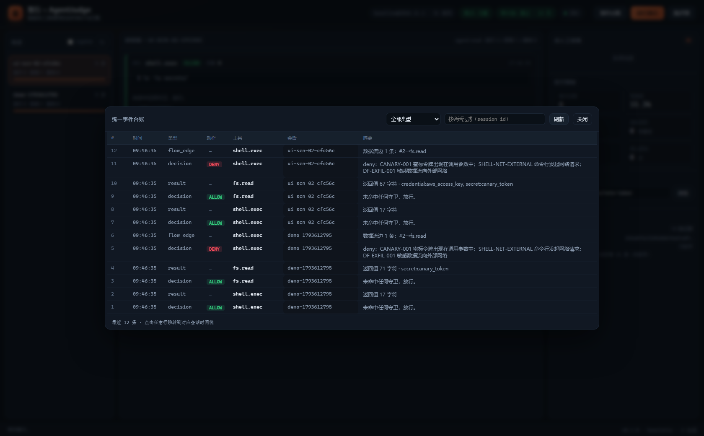

# 防篡改审计链

## 1. 记录结构

```json
{
  "seq": 42,
  "ts": "2026-11-02T09:24:25.123Z",
  "kind": "decision",
  "session_id": "s1",
  "action": "deny",
  "tool": "shell.exec",
  "payload": { "decision": { "...": "..." }, "call": { "...": "..." } },
  "prev": "6beb3710...",
  "current": "94395948...",
  "key_id": "k1"
}
```

`current = HMAC-SHA256(key, canonical_json({seq, ts, kind, payload, prev}))`

`canonical_json` = 键排序 + 紧凑分隔 + 保留非 ASCII。payload 入库前会做
JSON 化（超长字符串截断到 20k 字符，保证可解析）。

## 2. 记录类型

| kind | 触发 | payload 要点 |
| --- | --- | --- |
| `decision` | 每次裁决 | 完整 `Decision` + 脱敏后的调用参数 + 参数哈希 |
| `flow_edge` | 存在跨步骤数据流 | 数据流边（源步骤、标签、匹配方式） |
| `result` | 工具返回值登记 | 标签、长度、`sha256`、脱敏预览 |
| `revise` | 结果侧隔离 | 原决策号、隔离原因、命中项 |
| `review` | 人工复核 | 结论、复核人、备注 |
| `seal` | 封存尾锚（可选） | — |

审计里**不存明文密钥**：参数经 `mask_secrets` 脱敏，原文只留 `sha256` 指纹。

### 统一事件台账

工作台右上角「事件台账」把全部记录按时间倒序汇总，可按类型（裁决/返回值/数据流边/
隔离/复核）与会话过滤，点击任意一行跳到对应会话的时间线。深链：`/?ledger=1`。



API 对应 `GET /api/v1/audit/records?limit=150&kind=decision&session=...`；
命令行对应 `agentjudge audit records --limit 50 --kind review`。

## 3. 尾状态与独立尾锚

数据库内 `chain_tail` 表保存 `chain_tail`、`tail_count`、`hmac_tail`。
`hmac_tail = HMAC(key, "tail|{count}|{chain_tail}")`。

尾锚文件（默认 `var/tail.anchor`，**在数据库之外**）：

```json
{
  "chain_tail": "94395948...",
  "tail_count": 42,
  "hmac_tail": "4cfa...",
  "sealed_at": "2026-11-02T09:30:00.000Z",
  "key_id": "k1",
  "anchor_hmac": "b135..."
}
```

`anchor_hmac = HMAC(key, canonical_json({chain_tail, tail_count, hmac_tail, sealed_at, key_id}))`，
防止尾锚文件本身被改写。

封存时机：每 `seal_interval_s`（默认 300s）自动封存；`audit seal` 立即封存；
进程正常退出时也封存一次。

## 4. 校验算法

```
prev = 64 个 0（创世值）
for 期望序号 = 1..N:
    seq 必须连续（否则 sequence_gap）
    prev 必须等于上一条 current（否则 link_mismatch）
    payload 必须是合法 JSON（否则 payload_corrupt）
    重算 current 必须与存储值一致（否则 hash_mismatch）
链尾：库内 tail_count/chain_tail 必须与实际一致（否则 tail_mismatch）
      库内 hmac_tail 必须可重算（否则 tail_hmac_mismatch）
尾锚：自身 hmac_tail + anchor_hmac 必须有效（否则 anchor_mismatch）
      anchor.tail_count > 实际条数 → 记录被截断/清空（anchor_mismatch）
      anchor.tail_count == 实际条数 → 指纹必须一致（尾部被替换）
```

返回 `VerifyResult`：`ok`、`records`、`reason`、`broken_at`、`detail`、
`anchor_present`、`anchor_matches`、`anchor_detail`。

## 5. 攻击与检出对照

| 攻击 | 结果 |
| --- | --- |
| 改某条 `payload` | `hash_mismatch`（定位到该 seq） |
| 改内容并重算该条 HMAC | 下一条 `prev` 失配 → `link_mismatch` |
| 删中间一条 | 序号不连续 → `sequence_gap` |
| 删最后一条 | `tail_mismatch`；若同时改尾状态，则与锚不符 → `anchor_mismatch` |
| 清空整库 + 重建尾状态 | 锚的 `tail_count` 更大 → `anchor_mismatch` |
| 替换最后一条为旧记录 | `hash_mismatch`（seq/prev 参与签名） |
| 篡改锚文件 | 锚自身 HMAC 校验失败 → `anchor_mismatch` |
| 换掉密钥 | 首条即 `hash_mismatch` |

**前提**：攻击者没有同时拿到 HMAC 密钥与尾锚写入权限。因此生产环境务必：

- 密钥由 KMS / 环境变量注入，不落盘；至少 `chmod 600` 且与库分离备份；
- 尾锚写到独立介质（另一块盘、对象存储、只读挂载），或定期 `audit export` 异地留存；
- 至少一人在审计链之外保存过历史链尾指纹。

## 6. 取证导出

```bash
agentjudge audit export --out var/exports/case-2026-11-02.zip
```

zip 内含：

- `records.jsonl`：逐条记录（含指纹）
- `verify.json`：导出时的校验结论
- `tail.anchor`：独立尾锚
- `policy.json`：导出时生效的策略快照
- `README.txt`：复现方式

复核：

```bash
agentjudge audit verify --db <解出的 db> --anchor <解出的 anchor>
```

## 7. 密钥轮换

`Keyring` 支持旧密钥仅用于验证。轮换步骤：

1. 新密钥写入环境变量，旧密钥保留在 `keyring.old`；
2. 新记录使用新 `key_id` 签名；
3. 校验时按记录里的 `key_id` 选择密钥；
4. 全部历史链校验通过后，移除旧密钥。

当前 CLI 尚未暴露轮换参数，需在代码中构造 `Keyring(key, key_id, old={...})`。

## 8. 已知限制

- 链只保证「记录未被静默篡改」，不保证「记录一定发生过」——需要侧信道
  （网关日志、主机审计）交叉印证。
- 时间戳参与签名但不做可信时间源校验；可用 `ts` 排序，不应作为法律意义上的时间证据。
- SQLite 单文件受磁盘损坏影响；建议定期 `VACUUM`/备份，并保留导出包。
